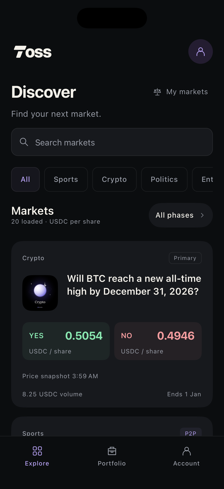
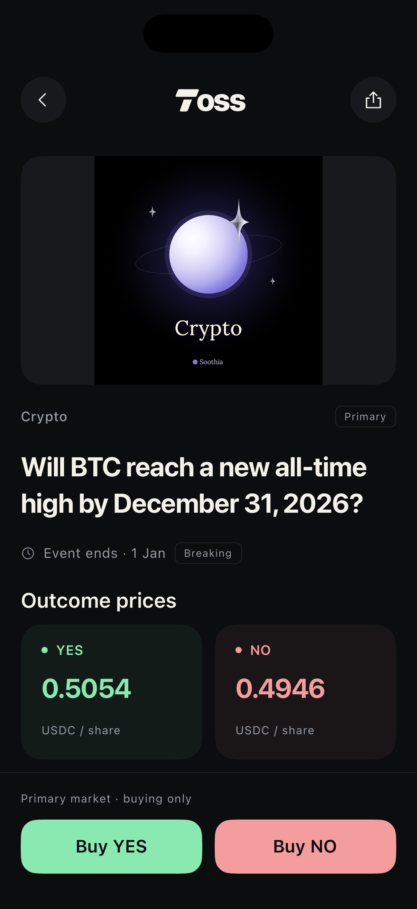
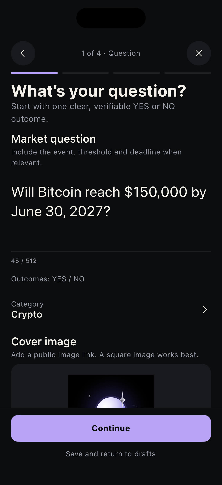

# Toss

**Prediction markets, made clear. Built on Panta.**

Toss brings prediction markets to iOS and Android in a focused, native mobile experience. Discover markets across crypto, sports, politics and more, explore YES and NO prices, and follow the events you care about. Sign in with Privy to access your wallet, track positions and take your view into a market.

## Inside the app

<table>
  <tr>
    <th>Discover markets</th>
    <th>Explore the details</th>
    <th>Create a market</th>
  </tr>
  <tr>
    <td></td>
    <td></td>
    <td></td>
  </tr>
</table>

- **Find your next market.** Search the catalog, browse categories and filter by market phase.
- **Understand the odds.** Inspect outcome prices, volume, timelines, resolution rules and market activity.
- **Back your view.** Choose YES or NO and review primary-market purchases or peer-to-peer orders before signing.
- **Keep your positions in view.** Access wallet balances and portfolio positions through your Privy account.
- **Ask your own question.** Build a market with a guided flow for the question, rules, timeline and cost review. Save drafts and return to them later.

## Built with

| Layer          | Technology                                |
| -------------- | ----------------------------------------- |
| Mobile         | React Native 0.81 · React 19 · TypeScript |
| Markets        | Panta API through a Node.js gateway       |
| Authentication | Privy                                     |

The mobile app connects to a gateway that handles authenticated Panta requests. Your Panta API key stays on the server; the app uses only public configuration.

## Run locally

### Requirements

| Tool    | Version / setup                                     |
| ------- | --------------------------------------------------- |
| Node.js | 22.11+ within 22.x, or 24.x                         |
| Bun     | 1.3.14                                              |
| iOS     | macOS, Xcode, Ruby 3.4+ and CocoaPods 1.16.2        |
| Android | JDK 17, Android Studio and an installed Android SDK |
| Panta   | Your own API key                                    |

### 1. Install and configure

From the repository root:

```sh
bun install --frozen-lockfile
cp .env.example .env.panta-server.local
```

Set your Panta key in `.env.panta-server.local`:

```dotenv
PANTA_API_KEY=pk_live_your_key_here
```

This file is ignored by Git and read only by the gateway. Keep the key out of mobile source and public configuration.

### 2. Start the gateway and Metro

Run each command in a separate terminal from the repository root. Keep both running while using the app.

**Panta gateway**

```sh
bun run catalog:gateway
```

**Metro bundler**

```sh
bun run start
```

### 3. Launch the app

#### iOS

Install the native dependencies and launch the simulator:

```sh
bundle install
cd ios
bundle exec pod install
cd ..
bun run ios
```

The default simulator is **iPhone 17 Pro**. To use another installed simulator:

```sh
bunx react-native run-ios --simulator="Your simulator name"
```

The Xcode workspace and internal native registration use the name `Rainbow`.

#### Android

Start an emulator or connect a device with USB debugging enabled, then run:

```sh
adb reverse tcp:8081 tcp:8081
adb reverse tcp:8787 tcp:8787
bun run android
```

### Gateway and authentication configuration

Local debug builds connect to `http://127.0.0.1:8787`. For a physical iPhone or a release build, set `deployedGatewayUrl` in [`src/lib/panta-api.ts`](src/lib/panta-api.ts) to your deployed HTTPS gateway. The included local gateway binds to loopback; use a secured server deployment for public access.

For your own Privy deployment, configure your public app/client IDs in both:

- [`src/features/panta/privy-config.ts`](src/features/panta/privy-config.ts)
- [`src/lib/panta-account-verification.ts`](src/lib/panta-account-verification.ts)

Both files must reference the same Privy app. Configure your native identifiers and allowed redirects in the Privy dashboard to match your build.

## Project structure

```text
src/features/panta/   Market discovery, trading, creation, wallet and portfolio
src/lib/panta-*.ts   API clients, account verification and transaction logic
src/design/         Design tokens, themes and styling
src/components/     Shared interface components
src/app/            App startup and root interface
tools/panta-gateway/ Server-side Panta gateway
tools/panta-wallet/  Wallet and transaction tests
tools/security/      Security checks
ios/                 iOS native project
android/             Android native project
```

## Checks

```sh
bun run lint
```

Runs formatting, TypeScript, configuration JavaScript, ESLint, generated design checks, dependency checks for both platforms, and gateway, wallet and security tests.

To run the test suites individually:

```sh
bun run test:catalog
bun run test:wallet
bun run test:security
```

## License and attribution

Toss is derived from Rainbow’s React Native codebase and retains parts of its design system and native scaffolding. The source is distributed under [GPL-3.0](LICENSE). Retain the license and applicable upstream notices when redistributing it.
